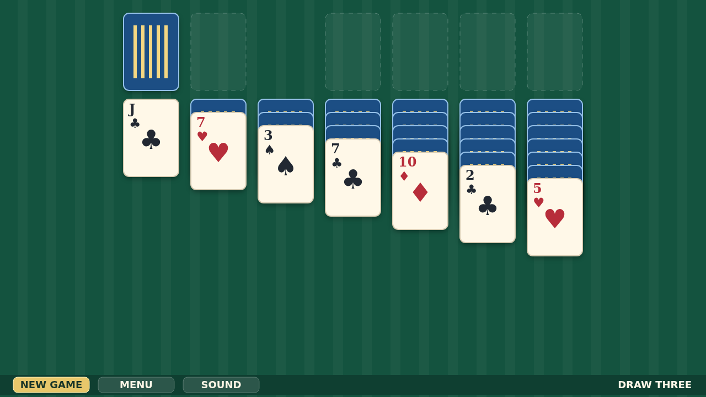
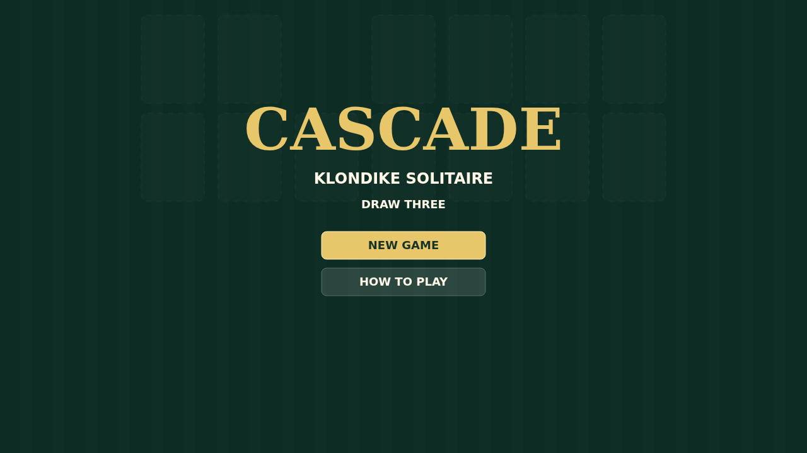

# Cascade

Cascade is a polished Draw Three Klondike solitaire played on a quiet green
felt table. Turn the stock, work the waste, and free buried tableau cards until
each suit can climb from Ace to King on the foundations.

Cards move by pointer, so a mouse and touchscreen feel the same. Drag a single
card or a whole alternating run, double-click exposed cards to send them home,
and use the bottom HUD when you want a fresh deal, the menu, or silence.

The ending is the signature flourish: when the final card reaches home, the
foundations burst into a gravity-driven cascade that scatters cards across the
table and leaves the felt covered in their trails.

